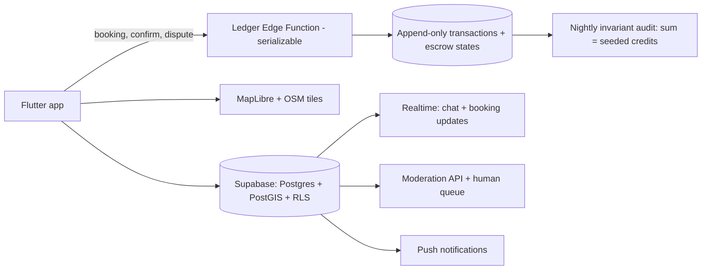

# Patchwork — an hour for an hour

Somewhere within a kilometer of you is a person who can fix the tap you've been ignoring, and they need exactly the guitar lessons you could teach in your sleep. No app connects you, because no money changes hands, and apps only get built where money changes hands. Patchwork is a marketplace with no prices, no gig-economy race to the bottom, and no money at all: teach an hour of guitar, earn one hour of credit, spend it on an hour of plumbing help from a neighbor. Time banking is a hundred-year-old idea that has always worked in small pockets and always died of paper administration and trust problems. Patchwork gives it what it never had: modern trust infrastructure, escrow, and a map.

## 1. Overview
- **Elevator pitch:** A hyperlocal skill-barter marketplace running on time credits: one hour given = one credit earned, spendable on anyone else's hour. Booking escrow, vouch-based trust tiers, dispute resolution, and anchor partnerships with libraries and community centers solve the problems that killed classical time banks. No cash option, ever — the absence of money is the product.
- **Category:** Marketplace / Community.
- **Tagline:** *An hour for an hour.*
- **Play Store positioning:** "The neighborhood marketplace where the currency is your time."

## 2. Problem & Why Now
Three converging failures create the opening. First, gig marketplaces financialized neighborly help and then priced out both ends: TaskRabbit's fees run 30%+ and its rates make small favors absurd ("$60 minimum to hang a picture"), while the person who'd happily do it for reciprocity has no venue. Second, loneliness statistics have become policy problems (national loneliness strategies exist in the UK and Japan; the US Surgeon General's advisory made "social infrastructure" mainstream vocabulary) — and reciprocal exchange is one of the few mechanisms that reliably converts strangers into weak ties, which is what neighborhoods are made of. Third, classical time banks — a proven model with 500+ US instances and decades of evidence — are dying of their tooling: spreadsheet ledgers, phone coordinators, no discovery, no trust layer beyond the coordinator's memory. The demand side is validated (hOurworld and TimeBanks.org's aging software still coordinates hundreds of thousands of exchanges annually); the product has simply never been built to consumer grade. Why now for a solo dev: this is a network-effects business that starts *hyper*-local — a single library partnership can bootstrap a functioning node — making it, unusually, a marketplace a small team can seed.

## 3. Target Audience & Personas
- **Amaia, 34, graphic designer, Bilbao.** Freelance, cash-tight, skill-rich. Offers logo help and Basque conversation; needs bike repair and occasional childcare swaps. Becomes a "Weaver" (trust tier 3) in four months; her vouch graph seeds her whole coworking space onto the app.
- **Walter, 67, retired electrician, Sheffield.** The classical time bank's hero user, finally with decent tooling. Offers electrical safety checks (within his insurance's hobbyist scope — the app's category guidance helped him figure that out); banks 40 credits; spends them on smartphone lessons and garden help. Time banking's documented superpower is making retirees feel *useful*, and Walter's five-star profile is full of the word.
- **Deepa, 41, library programs coordinator, Toronto (the anchor).** Runs the Patchwork hub at her branch: hosts the monthly repair-café-style meetup, holds "hub hours" where members exchange on-site, and adjudicates nothing (the app does) but vouches for newcomers (which the app weights). Her branch's node hit 300 members in a year; she has a dashboard and a lanyard and did not have to learn a spreadsheet.

## 4. Core Concept Deep-Dive
**The credit is an hour, and the hour is sacred.** One hour of anything equals one credit — guitar teaching, plumbing, dog walking, tax-form help. No skill multipliers, no surge, no negotiation. This radical flatness is time banking's founding principle (everyone's hour is equal) and also its best UX decision: no pricing screen, no haggling, no status anxiety. Quarter-hour granularity (0.25 credits) handles small favors. New members receive 2 starter credits (seeded by the system — mild, controlled inflation that solves the cold-start "no one can spend before earning" deadlock) and can go 3 credits into the red (the classic time-bank overdraft, which data from legacy banks shows is repaid in the overwhelming majority of cases — reciprocity is a stronger collector than a collections agency).

**Escrow makes promises real.** When Amaia books Walter's hour, one credit locks in escrow. On mutual confirmation ("it happened"), it transfers. No-show without cancellation? The wronged party keeps/receives the credit and the no-show eats a reliability mark. Cancellation windows (24h free, then escrow splits) are enforced by the ledger, not by awkwardness. This single mechanism — absent from every paper time bank — converts flakiness from a community-killing plague into a priced externality.

**Trust is layered, legible, and earned.** Four tiers: *Newcomer* (verified phone + photo; can book Tier-2+ members, limited to 2 open bookings), *Neighbor* (5 completed exchanges + 2 vouches; full booking), *Weaver* (20 exchanges, 5 vouches, clean record; can host group sessions, vouch with extra weight), *Anchor* (institution-affiliated humans — Deepa — whose vouches fast-track newcomers). Vouches are not likes: a vouch stakes a sliver of the voucher's own reputation (documented misconduct by a vouchee shades the voucher's graph), which keeps them meaningful. Identity verification tiers: phone (required), government-ID via Play-compliant provider (optional, unlocks in-home categories), and the anchor handshake (Deepa met you; the app records it). Category-sensitive gating: in-home services (childcare-adjacent, elder help) require the highest tier *and* are explicitly framed as help-between-neighbors with safety guidance — the app is opinionated that it is not a childcare platform and excludes unaccompanied minor care outright.

**Disputes get adjudication, not chargebacks.** A three-step ladder: structured self-resolution (the app narrates the ledger facts to both parties — most disputes are misremembered clocks), community panel (three randomly drawn Weavers from *outside* the node review anonymized evidence; panel service itself earns credits — the community moderates itself and is paid in its own currency), and staff backstop for safety issues. Everything appealable once; everything logged.

**The map is the marketplace.** Discovery is a warm map of your ~3km radius: skill pins, hub locations, "wanted" flags (asks are first-class objects, equal to offers — the shy person's entry point). Search by skill, by "can come to me / I'll go to them / meet at hub," by availability windows. Nodes (a neighborhood's membership) display collective stats — hours exchanged this month, the skill-diversity "quilt" visual — because the node, not the individual, is the unit of success.

**The quilt is the soul.** Every completed exchange adds a patch — colored by skill category — to the neighborhood's growing quilt visualization. A year-old node's quilt is a dense, beautiful fabric of hundreds of squares, each one two humans who met. It is the annual-report graphic, the town-hall slide, the tattoo (eventually, someone will).

## 5. Complete Feature Set
**MVP (v1.0):**
- Profiles with offers/asks (structured skill taxonomy + free text), photo, radius, availability windows.
- Map + list discovery, skill search, wanted-flags.
- Booking flow with escrow, calendars, reminders, cancellation windows, quarter-hour granularity.
- Ledger: balance, history, overdraft to −3, starter credits; every entry human-readable ("1.0 → Walter, 'fixed the hallway socket'").
- Trust: phone verification, vouches, tiers 1–3, reliability record, block/report.
- Post-exchange flow: mutual confirmation, optional note of thanks (public, on profile), private feedback.
- Node pages with the quilt, hub listings; in-app messaging (booking-scoped, no open DMs — messaging exists to coordinate exchanges, not to be a social app or a harassment surface).
**v1.x fast-follows:**
- Anchor toolkit: hub dashboard, event listings (repair cafés, skill-shares), anchor vouching, printable posters with node QR.
- Group sessions (one Weaver teaches six people bread-making; each attendee pays 1 credit, host earns per attendee — capped at 4/session to keep the hour sacred-ish while making teaching worthwhile).
- Dispute panel system; ID verification tier; household accounts (a family shares a balance).
**v2.0+:**
- Inter-node exchange protocol (visiting another city? your tier travels, credits work — the federation moment).
- Organizational members (the library itself offers meeting rooms for credits; a café offers its corner table — object/space lending enters the economy).
- Tool library module: physical item lending with the same escrow/trust rails.

## 6. Screen-by-Screen UX Walkthrough
Navigation: bottom bar — **Map**, **Search**, **Bookings**, **Ledger**, **You**.
- **Map (home):** the neighborhood, skill pins clustered, hub icons, a "this week in your node" ribbon (new members, upcoming hub events, quilt patch count). Top: the node quilt thumbnail — tap for the full fabric.
- **Search:** skill taxonomy browser + text; filters (distance, availability, tier, at-hub/at-home/remote-ok); wanted-flags feed ("Rosa asks: someone to explain pension forms — 1 hr").
- **Profile (other):** photo, tier badge, offers/asks, thanks-notes wall, reliability summary ("34 exchanges · shows up"), vouch chain ("vouched by Deepa (Anchor) + 4"), book button.
- **Booking flow:** pick offer → propose time from their windows → location (their place/your place/hub) → escrow explainer on first use (one screen, plain words) → confirm. Both parties get calendar cards.
- **Bookings:** upcoming/pending/past; each card carries chat, reschedule, cancel (with window countdown shown honestly), and day-of "it happened" confirmation buttons.
- **Ledger:** balance big and friendly; history as narrative lines; overdraft state shown as "the node has you covered — repay by helping anyone."
- **You:** your offers/asks editor, tier progress ("2 vouches from Neighbor"), your thanks wall, settings (radius, verification, quiet hours).
**Key flow — cold start in a new node (the existential flow):** install via library poster QR → phone verify → guided profile: "name two things you could do for an hour" (taxonomy suggestions fight blank-page: "explain something you're good at… fix… cook… translate…") + "name one thing you need" → 2 starter credits land with confetti-free warmth ("The node fronts you two hours. Pay it forward, literally.") → map shows the hub event this Saturday pinned first → RSVP costs nothing → at the event, Deepa's anchor-vouch bumps you to bookable. The app's honest answer to marketplace cold-start: route every newcomer through a warm room within seven days.
**Key flow — the dispute that isn't:** Walter marks "it happened," Amaia forgets for 48h → app nudges Amaia with Walter's completion note → one tap confirms → escrow releases. (Ledger telemetry from legacy banks says: design for forgetfulness, not fraud.)

## 7. Design Language
Warm civic modernism: cream and kraft-paper surfaces, patchwork accent palette (each skill category owns a fabric-swatch color — terracotta for repair, moss for growing, marigold for teaching), the quilt motif everywhere quietly. Type: a sturdy humanist sans (Source Sans 3) with a slab display face (Zilla Slab) for node names — municipal warmth, not startup gloss. Illustration over photography for system imagery (hands, tools, tables); member photos are the only faces. Motion: patches stitch in with a two-frame settle; nothing bounces. Tone of voice is the design system's core: "the node has you covered," "shows up," "pay it forward, literally" — neighborly, concrete, allergic to both corporate and cutesy. Accessibility: WCAG AA minimum, large-type mode tested with the Walter demographic as a first-class persona, not an audit item.

## 8. Technical Architecture
Opinionated stack: **Flutter** (this app must eventually meet its community members on cheap and old devices of every OS; pixel-perfect native feel matters less than reach and iteration speed) over a **Supabase** backend (Postgres + PostGIS for geo, Row-Level Security for privacy-by-default, Realtime for chat/booking updates, Edge Functions for ledger operations). The **ledger is the sacred component**: append-only `transactions` table, all mutations through a single serializable Edge Function enforcing invariants (escrow states, overdraft floor, zero-sum minus seeded credits), with a nightly invariant-audit job (global sum = credits seeded; any drift pages the dev). Maps: MapLibre + OpenStreetMap tiles (cost control, values alignment). Notifications: FCM. Moderation: text/image moderation API on profiles and thanks-notes, human review queue. Data minimalism: location stored as fuzzy home-area (geohash-5, ~5km), exact addresses only in confirmed bookings, purged 30 days post-exchange.

## 9. Data Model
- **Member:** `id`, `name`, `photo_ref`, `geohash_area`, `tier{newcomer|neighbor|weaver|anchor}`, `verifications[{phone|id|anchor_handshake}]`, `balance` (derived, cached), `reliability{completed, no_shows, late_cancels}`, `node_id`, `quiet_hours`.
- **Offer/Ask:** `id`, `member_id`, `type{offer|ask}`, `skill_taxonomy_id`, `title`, `description`, `location_mode{mine|yours|hub|remote}`, `active:bool`.
- **Booking:** `id`, `offer_id`, `provider_id`, `receiver_id`, `scheduled_at`, `duration_h` (0.25 steps), `location{mode, address_ref?}`, `state{proposed|confirmed|completed_pending|completed|cancelled|disputed}`, `escrow_tx_id`.
- **Transaction (append-only):** `id`, `type{escrow_lock|transfer|release|refund|seed|panel_award}`, `from_id?`, `to_id?`, `amount`, `booking_id?`, `created_at`, `memo`.
- **Vouch:** `voucher_id`, `vouchee_id`, `weight` (tier-derived), `created_at`, `standing{good|shaded}`.
- **Node:** `id`, `name`, `boundary_geo`, `anchor_ids[]`, `stats{hours_month, members, quilt_patches}`, `hub_locations[]`.
- **Dispute:** `id`, `booking_id`, `step{self|panel|staff}`, `panelist_ids[]`, `evidence_refs[]`, `resolution`, `appealed:bool`.
- **ThanksNote:** `booking_id`, `text`, `public:bool`.

## 10. Monetization
The hard question, answered by structure: **the exchange layer is free forever and carries no fees of any kind** — skimming the neighbors' hours would corrupt the commons and the community would rightly torch it. Revenue comes from the institutional ring around the commons: **Anchor subscriptions — $49/month per institution** (libraries, community centers, housing associations, municipalities, churches): the hub dashboard, event tooling, printable campaign kits, node analytics (aggregate only), onboarding support, and the standing that being an official civic anchor confers — priced against the community-programming budgets these institutions already spend (a single monthly workshop costs more). **Grants and civic contracts** are a real, unromantic revenue line: loneliness/social-cohesion funding exists at municipal and foundation level on multiple continents, and Patchwork's quilt-and-hours reporting is exactly what such funders require of grantees — the reporting module is grant-bait by design. Individual members: an optional **Patron badge — $2/month**, pure support with a small quilt-corner flourish, expectation-free (modeled on Signal/Wikipedia patronage; target 2–4% of MAU). No ads ever; member data is never sold, stated in a plain-language covenant. Sustainability math: one moderately successful metro (30 nodes, 12 anchors, 8k members) ≈ $7k MRR + grant capacity — small-team viable, which is the honest ambition; this is a mittelstand business wrapped around a commons, not a unicorn.

## 11. Play Store Listing
- **Title (≤30):** `Patchwork: Skill Time Bank` (25)
- **Short description (≤80):** `Trade hours, not money. Teach what you know, get help with what you don't.` (74)
- **Full description:** open with the tap-and-guitar story; blocks: An Hour Is an Hour (the flat credit), Real Trust, Not Star Ratings (tiers, vouches, escrow), Your Neighborhood's Quilt (nodes, hubs, events), No Money, No Fees, No Ads (the covenant), Start With Two Hours (the seed). Close with the anchor pitch line for institutions.
- **ASO keywords:** time bank, skill swap, barter app, neighborhood help, skill exchange, community app local, trade skills, help neighbors, timebanking, mutual aid app.
- **Content rating:** Everyone. UGC declarations (profiles, notes, chat) with report/block; booking-scoped messaging documented.
- **Policy notes:** no real-money transactions between users → clean of payments policy entanglement (Patron badge and anchor subs via Play Billing / web B2B respectively); location permission justified and minimal (fuzzy by default); in-home service categories carry safety guidance per Play's user-safety expectations for marketplace-like apps; tax framing (see Risks) kept accurate per jurisdiction in help content.

## 12. Growth & Marketing Plan
Marketplace physics dictates the plan: **density before breadth, institutions before individuals.** (1) Launch city strategy: one metro, 3–5 nodes, each anchored — sign 5 anchor institutions *before* public launch (libraries are the ideal first partner: mission-aligned, trusted, physically central, and starving for programming that brings people in; the pitch deck is the quilt). (2) The hub event is the funnel: monthly repair-café/skill-share formats with poster QR onboarding — every event converts 20–40 warm, pre-trusted members; Patchwork ships event-in-a-box kits (posters, name tags, run-of-show) so Deepa's setup cost is one email. (3) Press positioning: "the anti-gig-economy app" is an irresistible local-news and solutions-journalism story (every city paper wants the TaskRabbit-backlash piece; be it). (4) The quilt as shareable civic pride: node milestone cards ("Riverside traded 1,000 hours") designed for community Facebook groups and neighborhood WhatsApp — where this demographic actually is. (5) Legacy time-bank migration: hOurworld/TimeBanks.org communities get a white-glove import path (their coordinators become Anchors, their ledgers port) — hundreds of pre-formed communities with decades of goodwill and dying software. Expansion rule: a new city opens only with a committed anchor — growth follows institutions, never raw geography.

## 13. Analytics & KPIs
North star: **completed exchanges per active member per month** (target ≥ 1.2 at node maturity — legacy banks' healthy benchmark). Key events: `profile_completed{offers, asks}`, `starter_credits_spent_days`, `booking_created/confirmed/completed`, `no_show`, `dispute_opened{step_resolved}`, `vouch_given`, `tier_advanced`, `hub_event_rsvp/attended`, `node_quilt_shared`, `anchor_dashboard_wau`. Health thresholds: first exchange within 30 days ≥ 40% of verified members (the make-or-break activation); no-show rate < 8% (escrow's job); dispute rate < 2% of bookings with 80% resolved at self-service step; balance distribution healthy (Gini-style check — a node where 5 people hold all credits is a market failure; alert at threshold); overdraft repayment ≥ 85% in 90 days; node retention: hours/month still growing at month 12. The KPI review explicitly includes one qualitative feed: thanks-notes sampled weekly — the product is working when they mention names and second meetings.

## 14. Risks & Mitigations
- **Cold-start death (the marketplace killer):** anchor-first launches, starter credits, asks-as-first-class, and the seven-day warm-room rule; a node without an anchor and a calendar of events simply does not launch.
- **Safety incident in an in-home exchange:** tier-gating for in-home categories, ID verification option, meet-at-hub defaults for first exchanges, safety guidance in-flow, rapid staff backstop, and insurance/legal review per launch country; exclude high-risk categories (unaccompanied childcare, medical care) outright.
- **Tax/regulatory ambiguity:** in the US, IRS treatment of hour-for-hour time banks has historically been favorable (non-commercial mutual aid vs. barter exchanges); this is jurisdiction-specific — ship per-country help content written with counsel, and keep organizational members (v2) structured to avoid converting the commons into a commercial barter exchange.
- **Credit hoarding/inflation drift:** demurrage-free but monitored; seeded-credit supply tuned per node; group sessions and organizational sinks (v2 rooms/tools) create healthy spending outlets.
- **Moderation load on a small team:** panel system converts trusted members into paid-in-credits moderators; booking-scoped chat shrinks the abuse surface; anchors are local eyes.
- **Anchor churn:** the dashboard must save Deepa time versus her spreadsheet from week one; anchor success playbooks and a coordinator community (the anchors' own node, in effect).
- **Well-funded clone:** the moat is unfashionable: institutional relationships, per-jurisdiction care, and community trust compound slowly and copy badly. Speed matters less than depth here; say so in investor conversations and mean it.

## 15. Competitive Landscape
- **TaskRabbit / Airtasker:** cash gig marketplaces; solve availability, create nothing communal; their fee structures and rate floors are Patchwork's best marketing. Not competitors for the same exchange — competitors for the same *need*, and only sometimes.
- **hOurworld / TimeBanks.org (Community Weaver):** the legacy incumbents — mission twins, technology from another era, no consumer trust layer; treat as allies and acquisition-of-communities targets (migration path, coordinator respect, no scorched earth).
- **Nextdoor:** owns neighborhood attention, monetizes it with ads and anxiety; favors asking over structured reciprocity, has no ledger, no escrow, no trust tiers. Patchwork is what Nextdoor's "helpful neighbor" posts wish they were; expect feature-envy, not category entry (reciprocity ledgers don't sell ads).
- **Olio / Buy Nothing:** gift-economy apps (things, not time); adjacent philosophy, proven neighborly-app adoption at scale, no time dimension; likely partnership surface (their users are Patchwork's warmest cohort).
- **Facebook Groups / WhatsApp (the true incumbent):** free, present, and structureless — no discovery, no escrow, no memory of who showed up. Patchwork's pitch against them is Walter's profile: 34 exchanges, shows up.

## 16. Development Plan
Two-person team ideal (dev + community lead — this product's "sales" is community organizing; budget for it as engineering's equal), ~28 weeks to launch city. W1–3: ledger core + invariant suite (property-based tests on the transaction engine before any UI — the ledger's correctness is the company). W4–6: profiles, offers/asks, taxonomy, verification. W7–9: map/search (PostGIS + MapLibre), node model. W10–13: booking + escrow + cancellation windows + confirmation flows end-to-end. W14–15: vouches, tiers, reliability, block/report + moderation queue. W16–17: ledger UI, thanks-notes, quilt renderer (make it genuinely beautiful — contract illustrator for the patch system). W18–20: anchor MVP dashboard + event listings + QR onboarding. W21–24: pilot with 2 anchored nodes (recruited from week 1 in parallel by community lead), 150 members, full exchange cycles observed; iterate booking friction and no-show handling with real data. W25–27: hardening, store assets, press kit, launch-city event calendar. W28: public launch. **If behind:** cut group sessions, dispute panels (staff-adjudicate interim), and the quilt's fanciest rendering — never cut escrow, tier gating for in-home categories, or the anchor toolkit.

## 17. Moonshots
- **The Federation:** open protocol for inter-node credit recognition — visiting Weavers exchanging in any city; eventually, an open standard other time banks implement (Patchwork as the ActivityPub of reciprocity).
- **Municipal partnerships at scale:** cities seeding credits as civic stipends (volunteer firefighter hours, poll-worker hours entering the commons) — public service becoming spendable neighborliness.
- **Corporate volunteering rewire:** company volunteer-day hours earn *employees* personal credits in their home nodes — corporate CSR budgets funding actual neighborhood reciprocity instead of t-shirts.
- **The skills census:** aggregate, anonymized node data as civic knowledge ("this district is rich in carpentry and poor in digital literacy") for library programming and adult-ed planning — the commons informing the institutions that anchor it.
- **Intergenerational guarantee:** a designed program pairing 65+ members with under-30s across the teaching/tech-help axis — the exchange pattern legacy time banks report as their most life-changing, promoted from emergent behavior to flagship.
